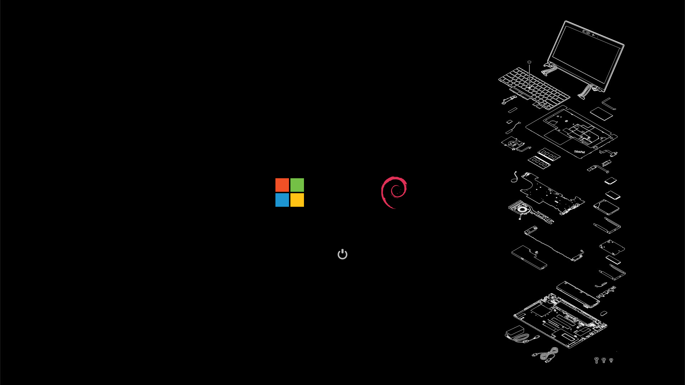

# rEFInd boot manager theme
This is my rEFInd theme. There are many like this, but this one is mine.\

This is a fork of [this theme](https://github.com/dr-marco/refind-t480-theme), but I customized basically everything: icons, icon size, boot menu options, background.\

OS Icons are from [here](https://github.com/NilsPvR/rEFInd-nils).\

